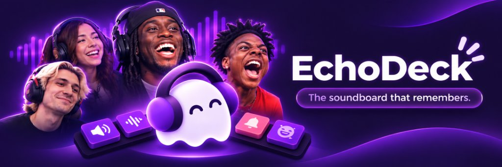

<p align="center">
  
</p>

<p align="center">
  
</p>

<h1 align="center">EchoDeck</h1>

<p align="center">
  <strong>The soundboard that remembers.</strong><br />
  A digital soundboard for Twitch streamers with viewer audio requests, OBS browser source routing, and live voice mimic challenges.
</p>

<p align="center">
  <a href="#demo-video">Demo Video</a> &bull;
  <a href="#how-it-works">How It Works</a> &bull;
  <a href="#core-features">Features</a> &bull;
  <a href="#quick-start">Quick Start</a> &bull;
  <a href="#architecture">Architecture</a>
</p>

---

## Demo video

<p align="center">
  <video src="EchoDeck_Outro_VSL.mp4" controls autoplay loop muted playsinline width="100%"></video>
</p>

---

## How it works

Streamers usually juggle hotkeys, audio cables, and discord bots just to play sound effects on stream. EchoDeck replaces that mess with three connected pieces:

1. **The Streamer Deck:** An on-screen ten-buzzer pad organized into pages. You fire sounds with clicks, your number keys 0 through 9, or an external Stream Deck keypad.
2. **The Twitch Viewer Extension:** A small panel sitting directly below the Twitch video player. Your viewers browse approved channel sounds and tap them to trigger audio live.
3. **The OBS Browser Source:** A lightweight web source you paste into OBS or Streamlabs. When you or a viewer tap a buzzer, the audio plays directly through your stream feed with sub-second response.

<p align="center">
  
  &nbsp;&nbsp;&nbsp;&nbsp;
  
</p>

---

## Core features

### Ten-key buzzer pages
- Keep ten sounds per page with clear labels, custom buzzer colors, and assigned keys.
- Switch between pages using arrow keys or `A` and `D`.
- Create dedicated pages for chat reactions, game-specific moments, or meme clips.

### Viewer sound controls
- Set channel cooldowns so chat cannot spam five loud clips at once.
- Configure per-viewer wait timers to prevent one viewer from dominating the audio.
- Restrict specific sounds to followers or subscribers.

### Mimic challenge
- Pick any sound in your library and record your voice trying to imitate it.
- Take up to three attempts per sound: one original take and two retries.
- Inspect your audio waveforms side by side with the original clip and get an automatic accuracy score.
- Pick your favorite take to keep as your official channel sound, or publish it to the community marketplace.

### Creator marketplace and library
- Browse community sounds by tag, genre, and creator.
- Preview sounds with waveforms before adding them to your deck.
- Keep a large personal library without cluttering your active ten-key performance pages.

---

## Architecture

EchoDeck coordinates viewer input, streamer control, and broadcast playback through an event queue:

```
[ Twitch Viewer Panel ]
         │ (Viewer requests via Twitch Extension)
         ▼
[ EchoDeck Sync Engine ] ◄── [ Streamer Web Deck (Keys 0-9 / Mouse) ]
         │
         ▼
[ OBS Browser Source ] ──► Live Stream Audio Output
```

- **Frontend:** Next.js (App Router), React 19, Tailwind CSS.
- **Audio engine:** Web Audio API, IndexedDB local audio caching, HTML5 Audio playback.
- **Extension:** Twitch Extension helper integration with standalone panel builds in `public/extension/`.

---

## Quick start

### Prerequisites
- Node.js 18 or newer
- npm or pnpm

### Installation

Clone the repository and install dependencies:

```bash
git clone https://github.com/Nbail-Oc/echodeck.git
cd echodeck
npm install
```

### Run the development server

```bash
npm run dev
```

Open [http://localhost:3000](http://localhost:3000) in your browser.

### Run the production build

```bash
npm run build
npm run start
```

---

## Repository layout

```
TWITCH/
├── app/                  # Next.js App Router pages and API routes
│   ├── deck/             # Streamer 10-key buzzer deck interface
│   ├── landing/          # Orbit-inspired full-screen landing page
│   ├── marketplace/      # Sound discovery and library catalog
│   ├── mimic/            # Voice mimic challenge studio
│   └── broadcast/        # OBS browser source audio receiver
├── components/           # UI components, layout shell, and widgets
├── public/
│   ├── images/           # Banner, mascots, and branding graphics
│   ├── sfx/              # Sample audio clips and sound effects
│   ├── stickers/         # Streamer reaction GIFs
│   └── extension/        # Twitch panel extension bundle
├── EchoDeck_Outro_VSL.mp4 # Video sales letter and outro walkthrough
└── index.html            # Standalone zero-dependency landing page
```

---

## License

MIT &copy; 2026 EchoDeck. Built for live creators.
